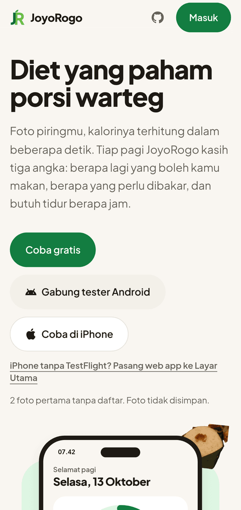
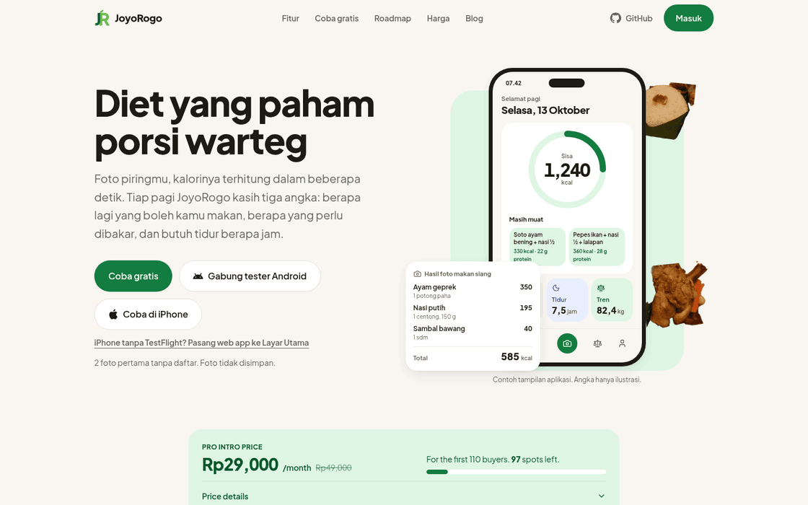

<p align="center">
  
</p>

<p align="center">
  Tiga angka tiap hari: boleh makan berapa, harus bakar berapa, butuh tidur berapa jam.<br>
  Foto piringmu, kalorinya dihitung AI. Open source, AGPL-3.0.
</p>

<p align="center">
  <a href="https://cloudagni.id/deploy/joyorogo"></a>
</p>

<p align="center">
  Tidak mau mengurus server? <a href="https://joyorogo.com">Pakai JoyoRogo Cloud</a>.
</p>

## Apa itu JoyoRogo

Pencatat diet untuk makanan Indonesia, di web, Android, dan iPhone. Latihan
(beban, lari, jam tangan) ada di aplikasi pendampingnya,
[JoyoFit](https://fit.joyorogo.com); JoyoRogo membaca hasilnya untuk angka bakar.

<p align="center">
  
  &nbsp;
  
</p>

## Fitur

**Mencatat makan**

- **Foto makanan, kalori keluar.** AI mengenali menu warteg sampai nasi padang
  dan mengisi kalori, protein, karbo, lemak. Foto asli tidak disimpan, kecuali
  kamu menyalakan "Simpan foto asli" di Profil (hanya bisa kamu buka sendiri).
  Hasil dikalibrasi dengan TKPI 2019; kalori dan makro hasil foto selalu
  perkiraan. Koreksi dengan mengetik atau bicara ("nasinya setengah aja").
- **Lupa foto? Ceritakan.** Ketik atau ucapkan "kemarin pagi nasi kuning pakai
  telur dadar, siang nasi padang"; AI menaruh tiap item di waktu makan dan hari
  yang tepat dan kamu cek dulu sebelum disimpan. Suara diubah jadi teks lewat
  Whisper di Workers AI dan tidak disimpan.
- **Minuman.** Catat minuman 0 kkal (air putih, Coke Zero) lewat foto atau
  teks. Gelas yang isinya tidak terlihat menawarkan pilihan jenis dan ukuran.
- **Barcode dan foto label gizi.** Produk yang belum terdaftar bisa difoto
  tabel gizinya; angkanya dibaca otomatis dan dipakai bersama
  ([docs/barcode-community.md](docs/barcode-community.md)).
- **Harga per piring.** Catat harga sepiring, lihat belanja makan per
  hari/minggu/bulan, nilai protein per rupiah, dan anggaran.
- **Puasa intermiten** (16:8, 18:6, 20:4, OMAD) dan **mode Ramadan** dengan
  jadwal makan dan pengingat.

**Target dan tubuh**

- **Target harian yang jujur.** Dari usia, tinggi, berat, aktivitas, dan target
  tanggalmu (Mifflin-St Jeor), lalu menyesuaikan dengan data makan dan timbangan.
  Angka Beranda: Sisa = target - dimakan. Tanggal target yang tidak aman
  diperingatkan, lengkap dengan tanggal realistis.
- **Naikin BB.** Berat target di atas berat badan: target TDEE ditambah surplus
  kecil, protein 1,6-2,2 g/kg ([docs/gain-mode.md](docs/gain-mode.md)).
- **Hamil dan Menyusui.** Tanpa defisit; target mengikuti AKG 2019 dan pita
  kenaikan berat IOM ([docs/maternal-mode.md](docs/maternal-mode.md)).
- **Berat, tren, lingkar perut.** Garis tren timbangan, perkiraan tanggal
  sampai, dan lingkar perut dibanding batas Asia dan rasio terhadap tinggi.
- **Olahraga dan tidur.** Catat manual, atau baca dari Health Connect (Android)
  dan Apple Health (iPhone). Strava lewat bagian bersama dengan JoyoFit
  ([docs/strava.md](docs/strava.md)); slot aplikasi Strava saat ini penuh, ada
  daftar tunggu.

**Bersama dan terhubung**

- **Grup dan feed.** Colek, catatan, VAR perut, tantangan, tempat, dan skor
  JoyoFit (Recovery, Strain, Tidur) dibagikan ke grup.
- **Berbagi.** Kartu progres dan cerita ke Instagram Story, salin, atau simpan.
- **JoyoFit.** Latihan beban dipindah ke JoyoFit
  ([docs/strength-moved.md](docs/strength-moved.md)); log lama tetap bisa dibaca
  dan diimpor. Latihan jam tangan Pro tersimpan di cloud
  ([docs/watch-workout-cloud.md](docs/watch-workout-cloud.md)).
- **Koneksi AI (Pro).** Tanya Claude atau ChatGPT tentang diary, berat, olahraga,
  dan tidurmu lewat konektor MCP read-only
  ([docs/mcp-connector.md](docs/mcp-connector.md); panduan pengguna di
  [joyorogo.com/panduan/ai](https://joyorogo.com/panduan/ai)).
- **Profil.** Hub dengan akun, langganan, target, makan, Strava, kesehatan,
  pengingat, tampilan, privasi, dan Koneksi AI.
- **Bahasa Indonesia dan English** di web dan native ([docs/i18n.md](docs/i18n.md)).
- **Pembaruan cepat (OTA)** untuk perbaikan JS di aplikasi native
  ([docs/ota.md](docs/ota.md)).

Data gizi lokal dari Tabel Komposisi Pangan Indonesia (TKPI) 2019. Halaman
[privasi](https://joyorogo.com/privasi) dan
[syarat](https://joyorogo.com/syarat) menjelaskan data yang disimpan.

## Tiga cara memakai

|                                                             | Untuk siapa                                                         | Biaya                                                                 |
| ----------------------------------------------------------- | ------------------------------------------------------------------- | --------------------------------------------------------------------- |
| [JoyoRogo Cloud](https://joyorogo.com)                      | Kebanyakan orang. Langsung pakai, tanpa setup.                      | Gratis dengan jatah scan AI harian. Pro untuk scan lebih banyak, bulanan atau tahunan, rupiah di Indonesia dan USD di luar Indonesia. Harga: [joyorogo.com/harga](https://joyorogo.com/harga), [docs/pricing.md](docs/pricing.md). |
| [Deploy di CloudAgni](https://cloudagni.id/deploy/joyorogo) | Klinik, gym, ahli gizi, atau keluarga yang ingin servernya sendiri. | Paket CloudAgni, kuota AI sudah termasuk.                             |
| Cloudflare sendiri                                          | Developer yang ingin mengurus semuanya sendiri.                     | Akun Cloudflare-mu, termasuk tagihan Workers AI.                      |

Langganan Pro di JoyoRogo Cloud membiayai pengembangan proyek ini.

## Arsitektur

```
web (Vite, React)  ──┐
native (Expo)      ──┼─ oRPC ─▶ apps/server (Hono, Workers) ─▶ D1, R2, Workers AI
JoyoFit (watch-fit) ─┤                    │
Claude / ChatGPT   ──┴─ MCP (OAuth 2.1) ──┘
```

Satu API di Cloudflare Workers melayani web, native, JoyoFit, dan konektor AI.
Logika (target, TKPI, paywall, coach, pembacaan data konektor) ada di
`packages/api`, dipakai bersama oleh router oRPC dan endpoint `/mcp`. D1 menyimpan
data (skema Drizzle di `packages/db`), R2 menyimpan dokumen latihan dan dataset
opt-in, Workers AI menjalankan scan, koreksi, dan Tanya coach. Web adalah worker
aset dengan worker kecil untuk pratinjau share. Tabel folder ada di bagian
[Pengembangan](#pengembangan).


## Deploy di CloudAgni

<a href="https://cloudagni.id/deploy/joyorogo"></a>

1. Klik tombol di atas, masuk, pilih slug.
2. Siapkan OAuth client Google (jenis _Web application_) di
   [Google Cloud Console](https://console.cloud.google.com/apis/credentials).
   Form deploy menampilkan _authorized redirect URI_ yang harus kamu daftarkan,
   bentuknya `https://app.<slug>.cloudagni.id/api/auth/callback/google`.
3. Isi Client ID dan Client Secret, lalu deploy. Database, penyimpanan,
   HTTPS, dan secret aplikasi disiapkan otomatis.

Paywall, Strava, dan pembayaran (DOKU atau Pakasir) bisa diisi di form yang sama atau diubah nanti dari
halaman **Instans**. Biarkan kosong untuk JoyoRogo tanpa batas scan dan tanpa
halaman harga.

## Self-host di Cloudflare sendiri

Butuh akun Cloudflare, Bun, dan OAuth client Google. Pemakaian Workers AI,
Images, D1, dan R2 ditagih ke akun Cloudflare-mu.

```bash
bun install
cd apps/selfhost
bunx wrangler d1 create joyorogo          # salin database_id ke wrangler.jsonc
bunx wrangler r2 bucket create joyorogo-stickers
```

Di `apps/selfhost/wrangler.jsonc`, ganti `BETTER_AUTH_URL` dan `APP_URL`
dengan alamat publikmu (misalnya `https://joyorogo-mu.workers.dev`), lalu:

```bash
openssl rand -hex 32 | bunx wrangler secret put BETTER_AUTH_SECRET
bunx wrangler secret put GOOGLE_CLIENT_ID
bunx wrangler secret put GOOGLE_CLIENT_SECRET
bun run build && bun run deploy           # migrasi D1 + deploy worker
```

Redirect URI Google: `<alamatmu>/api/auth/callback/google`. Variabel opsional
(paywall, Strava, DOKU, Pakasir) ada di bawah; set dengan `wrangler secret put` atau di
`vars`.

## Paywall dan pembayaran

Pemilik server yang menentukan. Tanpa konfigurasi, semua fitur gratis tanpa batas.

| Variabel                                                 | Arti                                                                                                                                                                        | Bawaan |
| -------------------------------------------------------- | --------------------------------------------------------------------------------------------------------------------------------------------------------------------------- | ------ |
| `FREE_DAILY_SCANS`                                       | Batas scan AI per hari untuk pengguna gratis. Kosong = tanpa paywall.                                                                                                       | kosong |
| `FOUNDER_DAILY_CAP`                                      | Batas pengaman scan Pro per hari. Kosong = tanpa batas.                                                                                                                     | kosong |
| `ANON_SCANS`                                             | Coba scan tanpa daftar per perangkat. `0` mematikan demo.                                                                                                                   | 2      |
| `FOUNDER_PRICE_IDR`                                      | Harga Pro per bulan (dipakai saat `FOUNDER_PRICE_LADDER` kosong).                                           | 15000  |
| `FOUNDER_PRICE_LADDER`                                   | Tangga harga "pembeli:hargaBulanan[/hargaTahunan]", mis. `10:15000/149000,110:29000/199000,:49000/349000`: 10 pembeli pertama Rp15rb/bulan atau Rp149rb/tahun, pembeli 11-110 Rp29rb / Rp199rb, lalu Rp49rb / Rp349rb. Tanpa `/hargaTahunan` harga tahunan = `FOUNDER_YEARLY_PRICE_IDR` (maks 10x bulanan) atau 10x bulanan. Langkah awal tampil sebagai promo "Harga Founder (terbatas)"; pembeli promo itu mendapat lencana Founder. Pembeli = pengguna unik dengan minimal satu pembayaran. Yang pernah bayar mengunci harga terendahnya. Kosong = harga flat tanpa promo. | kosong |
| `FOUNDER_YEARLY_PRICE_IDR`                               | Harga Pro per tahun untuk harga flat dan cadangan harga Apple/Play (transaksi bukan IDR). Kosong = 10x harga bulanan. Langkah tangga dengan `/hargaTahunan` eksplisit mengabaikannya. Produksi: `199000`. Harga toko tidak berubah otomatis: lihat `docs/pricing.md`. | kosong |
| `BILLING_PROVIDER`                                       | Gateway untuk checkout tanpa pilihan metode (versi aplikasi lama): `doku` atau `pakasir`. Kosong = DOKU kalau diisi, kalau tidak Pakasir.                                   | kosong |
| `DOKU_CLIENT_ID`, `DOKU_SECRET_KEY`, `DOKU_BASE_URL`     | DOKU Checkout, tombol **Transfer Bank**. Pembayaran aktif hanya kalau `FREE_DAILY_SCANS` juga diisi.                                                                        | kosong |
| `PAKASIR_SLUG`, `PAKASIR_API_KEY`, `PAKASIR_WEBHOOK_SECRET` | Pakasir payment link khusus QRIS, tombol **QRIS**. Webhook proyek: `/api/billing/pakasir/webhook`.                                                                      | kosong |
| `PAKASIR_SANDBOX`                                        | `1` = pembayaran sandbox Pakasir ikut mengaktifkan Pro (uji coba saja).                                                                                                     | kosong |
| `POLAR_ACCESS_TOKEN`, `POLAR_WEBHOOK_SECRET`, `POLAR_PRODUCT_MONTHLY_ID`, `POLAR_PRODUCT_YEARLY_ID` | Polar (USD, merchant of record), opsi bayar kartu dolar di web untuk pembeli luar Indonesia. Mati sampai keempatnya diisi. Webhook: `/api/billing/polar/webhook`. Detail di `docs/pricing.md`. | kosong |
| `POLAR_PRICE_MONTHLY_USD_CENTS`, `POLAR_PRICE_YEARLY_USD_CENTS`, `POLAR_SERVER` | Harga yang ditampilkan dalam sen dolar (bawaan 999 / 5999; tagihan sebenarnya mengikuti harga produk di Polar) dan `sandbox` untuk sandbox-api.polar.sh. | kosong |
| `APPLE_BUNDLE_ID`                                        | Apple in-app purchase untuk Pro di iOS. Kosong = `com.joyodigitama.joyorogo`; harus sama dengan app di App Store Connect. Produknya tetap: langganan `com.joyodigitama.joyorogo.founder.monthly` dan `.yearly`. | kosong |
| `APPLE_SANDBOX_EMAILS`                                   | Email (pisah koma) yang boleh memakai pembelian sandbox/TestFlight: akunmu dan akun demo App Review. Production selalu diterima.                                            | kosong |
| `REVIEW_LOGIN_EMAILS`                                    | Email (pisah koma) yang boleh masuk dengan email + kata sandi: akun reviewer Google Play/App Store. Daftar tidak pernah membuka pendaftaran lewat email. Akun dibuat dengan `bun packages/auth/scripts/review-login.ts` (Pro gratis, sandi acak disimpan di `~/.config/joyorogo/review-login.txt`). Kosong = masuk dengan email mati. | kosong |
| `STRAVA_CLIENT_ID`, `STRAVA_CLIENT_SECRET`               | Impor olahraga dari Strava. Di JoyoRogo Cloud aplikasi Strava-nya dipakai bersama JoyoFit ([docs/strava.md](docs/strava.md)). | kosong |
| `VAPID_PUBLIC_KEY`, `VAPID_PRIVATE_KEY`, `VAPID_SUBJECT` | Web Push untuk pengingat puasa intermiten di web (cron tiap 5 menit). Kosong = pengingat web mati.                                                                          | kosong |

Pro bisa dibayar bulanan atau tahunan. Sebelum checkout, pembeli di Indonesia
memilih **QRIS** (Pakasir) atau **Transfer Bank** (DOKU); tombol hanya muncul
untuk gateway yang kredensialnya diisi, dan kalau cuma satu yang diisi pilihan
dilewati. Pembayaran DOKU dan Pakasir sekali bayar (tanpa perpanjangan
otomatis). Pembeli di luar Indonesia melihat harga USD dan membayar kartu lewat
Polar, berlangganan dengan perpanjangan otomatis. Notifikasi DOKU masuk ke
`/api/billing/webhook`, Pakasir ke `/api/billing/pakasir/webhook`, Polar ke
`/api/billing/polar/webhook`; semuanya tetap aktif selama kredensialnya diisi.
Di iOS, Pro dibayar lewat Apple in-app purchase (`/api/billing/apple`) dan di
Android lewat Google Play Billing, tanpa kredensial tambahan di server.

## Email

Email transaksional (struk pembayaran, notifikasi admin, pengingat habis
masa Pro) dikirim lewat Cloudflare Email Service. Tanpa konfigurasi,
email mati dan aplikasi tetap jalan. Untuk mengaktifkan:

1. Di dashboard Cloudflare, buka domain **joyorogo.com** → **Email** →
   **Email Service**, lalu onboard domain pengirim `mail.joyorogo.com`
   (Enable Email Sending; ikuti wizard DNS-nya).
2. Tambahkan binding `send_email` bernama `EMAIL` di `apps/server/wrangler.jsonc`
   (sudah ada di repo).
3. Set variabel: `EMAIL_FROM=halo@mail.joyorogo.com` (alamat di domain yang
   di-onboard), `EMAIL_FROM_NAME=JoyoRogo`, dan `EMAIL_REPLY_TO` (alamat
   balasan, opsional) supaya balasan pembeli masuk ke pemilik. Notifikasi admin
   dikirim ke daftar `ADMIN_EMAILS`.

Catatan: self-host tanpa binding/`EMAIL_FROM` otomatis mematikan email.

## Aplikasi Android dan iPhone

- **Android:** tes tertutup di Google Play (AAB), terhubung ke JoyoRogo Cloud.
  Gabung dari [joyorogo.com](https://joyorogo.com/#pasang). Pembaruan dalam
  aplikasi lewat Google Play ([docs/in-app-updates.md](docs/in-app-updates.md)).
- **iPhone:** beta publik lewat TestFlight; versi App Store 1.0 sedang
  menunggu review Apple.
- **Web:** bisa dipasang ke layar utama HP.

Untuk server sendiri, build dari source: ganti `EXPO_PUBLIC_SERVER_URL` di
`scripts/build-release-apk.sh` dan package id di `apps/native/app.json`, lalu
jalankan skrip itu (butuh Android SDK, JDK, dan Bun). Hasilnya
`dist/joyorogo-play-<versionCode>.aab`. Setiap build memberi `versionCode`
otomatis (menit sejak 2024-01-01 UTC), jadi selalu naik tanpa diubah manual.

## Pengembangan

Butuh [Bun](https://bun.sh). Monorepo Bun workspaces dengan Turborepo.

```bash
bun install                    # juga membuat tipe API dan env (varlock codegen)

# API (http://localhost:3000). Isi apps/server/.dev.vars, lihat apps/server/.env.schema
cd apps/server && bunx wrangler d1 migrations apply DB --local && bunx wrangler dev --port 3000

# Web (http://localhost:3001)
cd apps/web && VITE_SERVER_URL=http://localhost:3000 VITE_DEV_LOGIN=1 bun run dev:bare

# JoyoFit web (analisis latihan dan tidur, Pro), http://localhost:3003. Lihat docs/fit-web.md
cd apps/fit && VITE_SERVER_URL=http://localhost:3000 VITE_DEV_LOGIN=1 bun run dev:bare

# Aplikasi native (Expo)
bun run dev:native

# Admin console, http://localhost:3002 (dibatasi ADMIN_EMAILS di server)
cd apps/admin && VITE_SERVER_URL=http://localhost:3000 bun run dev
```

`DEV_LOGIN=1` di server dan `VITE_DEV_LOGIN=1` di web memunculkan tombol
"Masuk (dev)" tanpa Google, hanya untuk lokal.

Sebelum kirim perubahan:

```bash
bunx oxfmt --write <file yang diubah>
bunx oxlint
bunx turbo run check-types
bun test packages/api/src packages/auth/src packages/i18n/src packages/workout-view/src apps/server/src apps/native/src apps/fit/src
bun run i18n:check
bun scripts/roadmap-sync.ts --check   # kalau kamu mengubah docs/roadmap.json
```

### Build dan rilis

| Apa | Perintah |
| --- | --- |
| Build web | `cd apps/web && VITE_SERVER_URL=<alamat API> bunx --bun vite build`, lalu `bunx wrangler deploy` |
| Android (AAB) | `scripts/build-release-apk.sh --play`, atau workflow **Release Android** |
| iPhone | `scripts/build-ios-mac.sh` di Mac, atau workflow **Release iOS** ([docs/ios-mac.md](docs/ios-mac.md)) |
| Perbaikan JS tanpa build toko | `scripts/ota.sh "pesan"` ([docs/ota.md](docs/ota.md)); hanya JS dan aset, `--runtime` menampilkan runtimeVersion tanpa menerbitkan apa pun |
| APK QA di samping aplikasi asli | `scripts/build-qa-apk.sh` atau workflow **QA Android** |

Workflow rilis (`release-android.yml`, `release-ios.yml`, `ota.yml`) hanya jalan
manual dan memakai secret di environment `release`; rinciannya di
[docs/ci-release.md](docs/ci-release.md). `scripts/deploy.sh` dan
`apps/server/wrangler.jsonc` adalah konfigurasi JoyoRogo Cloud (akun pemilik);
untuk server sendiri pakai `apps/selfhost`.

### Isi repo

| Folder          | Isi                                                        |
| --------------- | ---------------------------------------------------------- |
| `apps/server`   | API Hono di Cloudflare Workers (D1, R2, Workers AI), termasuk endpoint MCP |
| `apps/web`      | Aplikasi web dan landing joyorogo.com (Vite, React, TanStack Router) |
| `apps/web/blog` | Blog statis: artikel Markdown, dirender saat build         |
| `apps/native`   | Aplikasi Android dan iPhone (Expo, update OTA lewat EAS Update) |
| `apps/admin`    | Konsol operator (admin.joyorogo.com)                       |
| `apps/selfhost` | API + web dalam satu worker, untuk CloudAgni dan self-host |
| `packages/api`  | Router oRPC dan logika (target, TKPI, paywall, billing, coach, konektor AI) |
| `packages/db`   | Skema Drizzle dan migrasi D1                               |
| `packages/auth` | Better Auth (Google, penyedia OAuth untuk konektor AI)     |
| `packages/i18n` | Teks id/en yang dipakai web dan native                     |
| `packages/sticker` | Mesin stiker dan kartu share ([docs/sticker-studio.md](docs/sticker-studio.md)) |
| `packages/ui`   | Komponen UI bersama                                        |

### Blog, SEO, dan pratinjau share

Artikel blog ada di `apps/web/blog/posts/*.md` (frontmatter `title`,
`description`, `date`, opsional `updated` dan `featured`). Baris
`::tkpi AP001 FP062` membuat tabel per 100 g dari TKPI 2019, `::porsi AP001 150
Nasi putih | FP062 70` membuat contoh porsi beserta totalnya, `::contoh` sama
tanpa total. Build menulis `/blog/`, RSS, dan `sitemap.xml`; `VITE_SITE_URL`
mengganti domain kanonik (bawaan `https://joyorogo.com`).

Judul, deskripsi, dan kartu share tiap halaman publik (`/`, `/harga`,
`/privasi`, `/login`) ada di `apps/web/src/lib/seo.ts`; build menulisnya ke
HTML statis masing-masing (`harga.html`, dst.) beserta JSON-LD halaman utama.
Gambar share `public/og.png` (1200×630) dibuat dari `apps/web/og/og-image.html`
dengan `bun run og` di `apps/web` (butuh Chromium).

Tautan `/gabung/<kode>`, `/p/<id>`, dan `/u/<handle>` punya pratinjau share
sendiri (crawler pratinjau umumnya tidak menjalankan JavaScript). Worker web
(`apps/web/worker`, `HTMLRewriter`) menulis judul, deskripsi, dan gambar ke
HTML halaman itu dari `GET /og/*` di API (`apps/server/src/og.ts`). Hanya
postingan publik dan profil publik yang tampil; yang privat atau tidak ada
memakai tag umum. Hasilnya di-cache sekitar semenit. Hanya tiga rute itu yang
melewati worker (`run_worker_first`); sisanya tetap dilayani langsung dari
aset. `API_URL` dan `SITE_URL` ada di `apps/web/wrangler.jsonc`. Versi
`apps/selfhost` belum memakai worker ini.

Pratinjau undangan (`group.preview`) bisa dibuka sebelum masuk, jadi dibatasi
60 permintaan per menit per IP lewat binding `INVITE_PREVIEW_LIMITER`
(`ratelimits` di wrangler); tanpa binding itu tidak ada batas. Yang keluar
hanya nama grup dan jumlah anggota. Tautan share dari aplikasi membawa
`utm_source=app-share` lewat `shareUrl` (web dan native); `/gabung` tetap tidak
dilacak Revklik dan kodenya dipotong dari data analitik.

## Dokumentasi

Catatan desain dan runbook ada di `docs/`:

| Topik | Dokumen |
| ----- | ------- |
| Harga, tangga founder, harga toko | [pricing.md](docs/pricing.md), [play-billing.md](docs/play-billing.md), [play-store.md](docs/play-store.md) |
| Mode Hamil/Menyusui dan Naikin BB | [maternal-mode.md](docs/maternal-mode.md), [gain-mode.md](docs/gain-mode.md) |
| Konektor AI (Claude, ChatGPT) | [mcp-connector.md](docs/mcp-connector.md) |
| JoyoFit: coach, latihan beban, sinkron cloud, Strava | [coach.md](docs/coach.md), [strength-moved.md](docs/strength-moved.md), [watch-workout-cloud.md](docs/watch-workout-cloud.md), [strava.md](docs/strava.md) |
| Scan makanan: akurasi, barcode | [ai-accuracy-review-2026-10-17.md](docs/ai-accuracy-review-2026-10-17.md), [ai-accuracy-log.md](docs/ai-accuracy-log.md), [accuracy-digest.md](docs/accuracy-digest.md), [ai-clef-probe.md](docs/ai-clef-probe.md), [barcode-sources.md](docs/barcode-sources.md), [barcode-community.md](docs/barcode-community.md) |
| Berbagi dan stiker | [story-sharing.md](docs/story-sharing.md), [sticker-studio.md](docs/sticker-studio.md) |
| Rilis: CI, OTA, iOS, pembaruan dalam aplikasi | [ci-release.md](docs/ci-release.md), [ota.md](docs/ota.md), [ios-mac.md](docs/ios-mac.md), [in-app-updates.md](docs/in-app-updates.md) |
| Bahasa, merek, email, UTM | [i18n.md](docs/i18n.md), [brand-marks.md](docs/brand-marks.md), [broadcast-email.md](docs/broadcast-email.md), [utm.md](docs/utm.md), [marketing/marketing-plan.md](docs/marketing/marketing-plan.md) |

## Roadmap

Yang sedang dan akan dikerjakan, dari daftar kerja kami. Sumbernya satu berkas,
[`docs/roadmap.json`](docs/roadmap.json): landing page joyorogo.com membacanya,
dan bagian ini dibuat ulang dengan `bun scripts/roadmap-sync.ts`. Roadmap
[JoyoFit](https://github.com/dzulfikar08/joyofit#roadmap) ada di repo-nya.

<!-- roadmap:start -->
<!-- Dibuat oleh scripts/roadmap-sync.ts dari docs/roadmap.json. Ubah file itu, jangan bagian ini. -->

**Sedang dikerjakan**

- Kartu dan stiker share baru untuk rekap harian, makanan, streak, dan progres berat
- Bayar dengan USD (kartu internasional) untuk pengguna di luar Indonesia. Sudah bisa di web.
- Tersedia di lebih banyak negara

**Berikutnya**

- Sticker Studio: bikin stiker share sendiri
- JoyoRogo di App Store (sedang direview Apple)
- Daftar resmi di direktori konektor Claude dan ChatGPT

**Nanti**

- Tantangan "Balik rutin" setelah Lebaran

Diperbarui 2026-10-18. Tanpa tanggal rilis: urutan di tiap kelompok bukan janji jadwal.
<!-- roadmap:end -->

## Berkontribusi

Issue dan pull request diterima. Untuk perubahan besar, buka issue dulu supaya
arahnya cocok. Sebelum membuka PR, jalankan pemeriksaan di bagian
[Pengembangan](#pengembangan); CI (`.github/workflows/ci.yml`) menjalankan
typecheck, build, tes, dan `i18n:check` tanpa secret, jadi aman untuk fork.
Teks aplikasi harus ada di `id` dan `en` (`packages/i18n`).

## Lisensi

[AGPL-3.0](LICENSE). Kalau kamu menjalankan versi yang diubah sebagai layanan
publik, kodenya juga harus dibuka untuk penggunanya. Nama dan logo JoyoRogo
bukan bagian dari lisensi kode; lihat [NOTICE](NOTICE) untuk merek dan sumber
data (TKPI 2019 Kemenkes, Compendium of Physical Activities).
