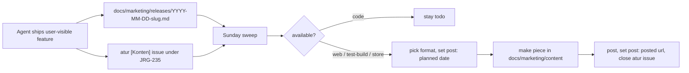

# Social playbook: JoyoRogo + JoyoFit

Written 2026-10-20. Covers Threads, Instagram and TikTok for both apps, static formats first (infographics, carousels,
feature updates), video later. It sits next to [`marketing-plan.md`](marketing-plan.md), which still owns positioning,
the claim ledger (section 1.1), SEO, Play/ASO, partnerships and Ramadan. Where the two disagree on social, this file
wins:

- Order of formats: static carousels and infographics now; the video hooks in marketing-plan section 3.4 become
  carousel and infographic briefs until the static system runs on its own (section 9).
- Channel order: Threads is the channel with proven reach (section 1). Instagram and TikTok reuse the same 1080x1350
  files (TikTok photo mode takes carousels).
- JoyoFit is in scope. It drove most of the reach in the last 30 days.
- Every user-visible feature becomes a release entry and an atur issue (section 6), so nothing ships unmarketed.

---

## 1. Threads audit (@dzulfikar.at, 20 Sep to 19 Oct 2026)

Source: Threads Insights read in Helium on 2026-10-20 (account overview, Top content, per-post insights).

| Metric (30 days) | Value | Change |
| --- | --- | --- |
| Views | 243,774 | +13.2% |
| Viewers | 67,346 | +0.6% |
| Interactions | 2,735 | +67.5% |
| Followers | 356 | +105 net |
| Viewers who are followers | 208 of 67.3K | |

Audience: 93.6% of viewers in Indonesia, mostly men 25 to 34. Top communities among viewers: Running Threads 5.5K,
AI Threads 4.3K, Tech Threads 1.7K, Cycling Threads 1.7K, Coffee Threads 1.4K. Most active: Thursday, Sunday and Friday,
13.00 to 16.00 WIB.

### 1.1 Top posts

| Post (first line) | Product | Views | Profile visits | Follows | Like / reply / share rate |
| --- | --- | --- | --- | --- | --- |
| reverse engineer huawei health (4 lines of what it adds) | JoyoFit | 51,853 | 1,875 | 42 | 1.65% / 0.52% / 0.24% |
| huawei kalian ada pajak strava? kenalin JoyoFit | JoyoFit | 22,512 | 1,416 | 17 | |
| 👀👀👀 very soon on iOS | JoyoFit | 8,058 | 2,005 | 15 | 0.98% / 0.34% / 0.02% |
| efek viral versiku: diplagiat, dijual $5 | other | 7,005 | 1,004 | 1 | |
| Alhamdulillah mari bangun candi | other | 5,230 | 588 | 0 | 0.9% / 0.99% / 0.11% |
| day 1 programmer diet: ngurangin kalori ❌ bikin aplikasi ✅ | JoyoRogo | 4,208 | 75 | 0 | |
| apakah minum minuman 0 kalori batalin puasa IF? (Diet Threads) | JoyoRogo | 3,095 | 227 | 2 | |
| share ala2 strava ✅ data detail ala strava pro ✅ | JoyoFit | 2,655 | 606 | 2 | |

### 1.2 Bottom of the product posts

| Post | Views | What went wrong |
| --- | --- | --- |
| Next, connect ke timbangan 👀👀 | 45 (16 h) | No context for anyone who missed the earlier thread |
| Di update terbaru aplikasi JoyoRogo, kita tidak hitung kalori target dari asumsi TDEE umumnya... | 275 | One wall of jargon (BMR, TEF, calibration layer); it also describes the model before the 19 Oct change, see 1.4 |
| Bisa parah gini 💀💀 | 342 | Image-only joke, first line says nothing |
| Abis foto makan tapi cuma makan sebagian? we got you! | 345 | Good feature, buried behind a vague opener; shown as text, not as a before/after |
| agar yhha bisa join ygga 🤣🤣 | 596, 0 likes | In-joke |
| 4 hari setelah rutin nyatetin kalori... turun -1,7kg | 589 | Personal result post with no hook on line 1; also a weight-loss claim we should avoid making the centre of a post |

### 1.3 What the numbers say

1. A sharp problem on line 1 travels. The three biggest product posts each name a pain that a defined group already
   feels (Huawei Health, the Strava upload, iOS access). The weak ones open with a joke, an emoji, or a feature name.
2. JoyoFit reaches 10 to 100 times further than JoyoRogo today. JoyoFit answers a pain owned by a community (Huawei
   watch owners who run and ride). JoyoRogo posts so far describe features. The JoyoRogo post that did travel was a
   question people could answer in one word ("apakah 0 kalori batalin puasa IF?", 3,095 views, posted in Diet Threads).
3. Reach does not turn into followers. 51.8K views gave 42 follows, and 1,875 profile visits gave about 2% follows.
   The bio says "programmer diet" with one link to joyorogo.com, while the traffic came for JoyoFit.
4. Almost all reach is from non-followers through the home feed (97.4% of the top post's views). Hooks matter more than
   follower count; posting into the right community topic matters (Running, Cycling, Diet).
5. Community posts make people curious about the person: the contributor shoutout for watch faces had 536 views but
   215 profile visits (40%).
6. Putting the link in the second post of the thread worked; the top post kept its reach. Keep doing it.
7. Reply threads are the product feedback loop: the "[Threads]" issues in atur (JRG-155 to JRG-171) all came from
   replies. They are also free content: "kalian minta, sudah jadi" posts (section 4).

### 1.4 Fixes, in order

1. Bio and links (5 minutes): name both apps and add the second link. Suggested bio:
   `bikin JoyoRogo (catat makan dari foto) dan JoyoFit (jam Huawei tanpa Huawei Health). open source, Malang.`
   Links: joyorogo.com, fit.joyorogo.com. Pin one "mulai dari sini" thread (section 5, Wed 21 Oct piece).
2. Line 1 rule: every product post names the reader's problem or asks a question they can answer. No emoji-only or
   in-joke openers on product posts.
3. Show, then tell: product posts carry a carousel or a before/after image, never a wall of text.
4. Post product content into topics where the readers are: JoyoFit into Running/Cycling, JoyoRogo into Diet.
5. Post product pieces Thursday, Sunday, Friday around 13.00 WIB.
6. Correct the 19 Oct target-calculation post with the carousel `joyorogo-cara-hitung-target`: since the 19 Oct
   commit the eat target is BMR times the activity level the user picks, minus the deficit, and watch or phone data
   only adds on top. Reply to the old post with the carousel.
7. Before announcing an app build, check it does not crash on first open. The iOS teaser reached 8K views and the
   first visible reply was a TestFlight crash.
8. Keep at least half of the posts about the products; the B2B, AI and dev posts are fine, they reach the same AI/Tech
   communities.

---

## 2. Accounts and handles

The owner decided on the handle `joyorogo` for TikTok and Instagram on 18 Oct (atur JRG-141). Checked on 2026-10-20:

| Handle | Instagram | TikTok | Threads |
| --- | --- | --- | --- |
| joyorogo | Exists: display name "_iamjoyorogo", 0 posts, 69 followers (taken unless it is ours) | Taken (personal account "Mary joy Orogo") | No profile (Threads needs the Instagram account) |
| joyorogo.com | Free (checked 20 Oct) | Free (checked 20 Oct) | Follows the Instagram handle |
| joyorogocom | Free | Free | Follows the Instagram handle |
| joyorogo.id | Free | Free | Follows the Instagram handle |
| joyorogoapp | Free | Free | Follows the Instagram handle |
| joyorogo.app | Free | Free | Follows the Instagram handle |
| joyofit | Taken (church community) | Taken (private) | |
| joyofit.id, joyofit.app, joyofitapp | Free | Free | |

`joyorogo` cannot be identical on both platforms because TikTok is taken, and Instagram rejects `joyorogo.com` as a
username (tested 20 Oct). The first account, `joyorogocom` (created 20 Oct from a desktop browser), was disabled by
Instagram the same day without review (JRG-307). Its replacement, `joyorogo_com`, was created on 27 Oct from the
phone app and runs a week of normal use before any link or automation; TikTok takes the same handle once the brand SIM
exists, and Threads follows Instagram. Register `joyofit.id` on Instagram and TikTok to hold the name, without posting.
One brand account carries both apps until JoyoFit has its own weekly content volume: Pro is shared, the domain is
shared, and one person runs it.

Roles:

| Account | Job |
| --- | --- |
| @dzulfikar.at (Threads, personal) | Main voice. Build in public, first-line hooks, replies, requests. Reach comes from here. |
| Brand account (IG, TikTok, Threads) | Catalogue: every carousel, infographic and update, so a new visitor finds all of it in one grid. Reposts the founder's best threads. |

Profile setup for the brand account:

- Name: `JoyoRogo · diet & JoyoFit`
- Bio: `Catat makan dari foto, makanan Indonesia. JoyoFit: jam Huawei tanpa Huawei Health. Gratis, open source, Malang.`
- Link: `https://joyorogo.com/?utm_source=instagram&utm_medium=bio&utm_campaign=evergreen-bio` (TikTok:
  `utm_source=tiktok`). When link-in-bio allows several links, add
  `https://fit.joyorogo.com/?utm_source=instagram&utm_medium=bio&utm_campaign=evergreen-bio`.
- Avatar: the green armored mascot from `apps/web/public/mascot/` on a plain background (marketing-plan 1.6).
- Highlights (Instagram): Update, Infografis, JoyoFit, Cara pakai, Harga.

---

## 3. Formats

All static pieces are 1080x1350 (4:5). Sources live in `docs/marketing/content/<slug>/` and render with
`bun docs/marketing/content/render.ts <slug>` to `dist/marketing/<slug>/` (see `content/README.md`).

| Format | Shape | Use for | Line 1 / cover rule |
| --- | --- | --- | --- |
| Infografis | 1 image | One number comparison from TKPI or a cited tip | The comparison itself ("3 gorengan = 200 g nasi") |
| Carousel | 5 to 8 slides | A problem and how the app answers it; explainers | Cover names the reader's problem |
| Update fitur | Cover + 1 feature per slide + CTA | Releases from the queue (section 6) | "Update JoyoRogo · <tanggal>" and how many features |
| Rilis minggu ini | 1 image or short carousel, Sunday | Everything that reached users that week, both apps | "Minggu ini di JoyoRogo & JoyoFit" |
| Kalian minta, sudah jadi | 1 to 2 images | A request from replies that shipped | Quote the request only with the asker's permission; otherwise paraphrase |
| Pertanyaan | Text only, Threads | Starts replies in a topic, sets up a later feature post | A question answerable in one word |
| Build in public | Text + 1 screenshot | Founder diary ("programmer diet minggu ke-2"), numbers, mistakes | A number or a stake |

Every piece: one CTA, a UTM link (`docs/utm.md`: `utm_source=threads|instagram|tiktok`, `utm_medium=social`,
`utm_campaign=<yyyy-mm>-<topic>`, for example `2026-10-update-fitur`), and on Threads the link goes in the second post.

---

## 4. Cadence

| Channel | Volume | Notes |
| --- | --- | --- |
| Threads, @dzulfikar.at | 1 product post a day, plus replies | Product pieces Thu, Fri, Sun 13.00 WIB first |
| Instagram, brand | 3 to 4 carousels or infographics a week | Same files as Threads |
| TikTok, brand | Same 3 to 4 pieces as photo carousels | Add a trending sound only if it does not talk over the text |

Weekly time (inference, adjust): 2 h to make 3 pieces from templates, 20 minutes a day of replies, 30 minutes for the
Sunday sweep and review (section 6).

---

## 5. First two weeks (21 Oct to 1 Nov 2026)

Pieces marked "ready" were rendered on 2026-10-20 from `docs/marketing/content/`; their full captions are in each
`caption.md`. The last column is the opener for Threads (post the link as a reply, section 3).

| Date | Piece | Product | Status | Threads line 1 |
| --- | --- | --- | --- | --- |
| Wed 21 Oct | Carousel `joyofit-tanpa-huawei-health` (pin it) | JoyoFit | ready | punya jam Huawei tapi males buka Huawei Health? ini isi JoyoFit sekarang |
| Thu 22 Oct | Update fitur `joyorogo-update-2026-10-20` | JoyoRogo | ready | 6 fitur baru di JoyoRogo minggu ini. salah satunya: hasil scan salah? tinggal bilang "telor cuma makan 1" |
| Fri 23 Oct | Infografis `infografis-gorengan-vs-nasi` | JoyoRogo | ready | 3 gorengan + kerupuk kira-kira sama kalorinya dengan 200 g nasi putih |
| Sat 24 Oct | Pertanyaan (Diet Threads) | JoyoRogo | write on the day | kalian ngitung kalori minuman nggak? es teh, kopi susu, atau cuma makanan? |
| Sun 25 Oct | Rilis minggu ini (JoyoFit releases with `available` web or test-build) | JoyoFit | make from queue | minggu ini di JoyoFit: (list from queue) |
| Mon 26 Oct | Carousel `joyorogo-cara-hitung-target`; reply it under the 19 Oct post | JoyoRogo | ready | target makanmu di JoyoRogo dihitung dari mana? begini rumusnya sekarang |
| Tue 27 Oct | Carousel: Recovery, Strain, Readiness dijelaskan | JoyoFit | to make | jam kamu bilang recovery 40%. artinya apa, dan dihitung dari apa? |
| Wed 28 Oct | Infografis: kalori minuman (tip `kalori-cair-es-teh-kopi`, sources in `tips.ts`) | JoyoRogo | to make | es teh manis vs kopi susu gula aren, mana yang diam-diam makan jatah kalorimu? |
| Thu 29 Oct | Kalian minta, sudah jadi: Bahasa Inggris (Threads request, JRG-170) | JoyoRogo | to make | ada yang minta JoyoRogo bisa bahasa Inggris. sekarang bisa |
| Fri 30 Oct | Carousel: kartu share dan kirim ke Strava | JoyoFit | to make | lari pakai jam Huawei, hasilnya bisa dipamerin kayak gini |
| Sat 31 Oct | Build in public: programmer diet minggu ke-3 | JoyoRogo | write on the day | (a real number from the week: days logged, features shipped) |
| Sun 1 Nov | Rilis minggu ini (both apps, from queue) | both | make from queue | minggu ini di JoyoRogo & JoyoFit |

---

## 6. Feature to post pipeline

The rule lives in `AGENTS.md` of both repos; the entry template is `docs/marketing/releases/README.md` (same in
watch-fit). The parent atur issue is JRG-235.

Sunday sweep (30 minutes):

1. Catch what agents missed: `git log --since=<last sunday> --no-merges --pretty='%ad %h %s' --date=short` in
   joyorogo and watch-fit, compared with the new files in both `docs/marketing/releases/`. Write the missing entries and
   atur issues.
2. Refresh `available` for every entry still at `code` or `test-build` (new build, OTA, deploy, store release).
3. Pick next week's pieces: features whose `available` is `web`, `test-build` or `store` and whose `post` is `todo`.
   One Update fitur carousel per app per week when there are three or more; a single strong feature gets its own
   carousel. Set `post: planned <date>` and the atur issue's target date.
4. After posting, set `post: posted <url>` and move the atur issue to Done.
5. Log the week's numbers (section 8).

---

## 7. Claims to avoid

Everything in marketing-plan section 1.1 ("Never say" column and the line under the table) applies. Added for the
current feature set:

- Availability: Android is a Google Play closed test, iPhone is TestFlight, App Store 1.0 is in review. Never "tersedia
  di Play Store / App Store" until `available: store`. Code on master is not a release.
- Huawei: no Huawei or Honor logos or product renders; no "official", "kerja sama", "hack", "bypass", "unlock". Say
  "tidak berafiliasi dengan Huawei". JoyoFit's watch protocol is a Gadgetbridge port; credit it rather than saying "kami
  reverse engineer Huawei" in branded pieces (the founder's own voice on Threads is his call). Only the Watch Fit 4 Pro
  is tested; "61 model bisa dicoba" means experimental. Honor Watch 5, 5 Pro and 6 are not supported.
- WHOOP: Recovery/Strain is "terinspirasi WHOOP, bukan produk WHOOP" on the site; leave the WHOOP name and logo out of
  branded pieces.
- Strava: official "Connect with / Compatible with / Powered by Strava" artwork only, unmodified, never in stickers or as
  a headline; "kirim latihan ke Strava", not "pengganti Strava"; the athlete slots are limited (waitlist). Never say
  "Strava gratis" flat: it is "gratis selama slot masih ada; unggah manual selalu bisa", and never tie Strava to Pro or
  paying (Strava API Policy 5.8), docs/strava.md "Capacity".
- Health numbers (kcal from heart rate, fat and carb burn, Recovery, VO2max, sleep need, scale body composition) are
  "perkiraan, bukan alat medis". Hamil/Menyusui: estimates, "tanya dokter atau bidan", no weight-loss framing. Naikin
  BB: no "naik X kg" or muscle promises. Keluarga: consent-based, not an emergency or fall-detection system.
- Coach: the daily suggestion and plans are rule-based ("tanpa AI"); Tanya coach uses AI, so never say "tanpa AI" about
  the chat.
- Claude/ChatGPT: no logos; "konektor read-only".
- Prices follow the buyer ladder: read `/api/config` the same day. "Rp0 selamanya" is the JoyoFit app, not cloud sync or
  Coach.
- Replies and quotes from Threads users: only with their permission, with handle.
- Weight results (including the founder's own): fine in a personal build-in-public post, never the headline of a
  branded piece.

The full list with file references is in the 2026-10-20 inventory (`docs/marketing/feature-inventory-2026-10-20.md`).

---

## 8. Measurement

Per post (Threads Insights per post, Instagram Insights, TikTok analytics): views, profile visits, follows, shares.
Profile visits and follows matter more than likes for us (section 1.3).

Per week (Sunday), one row in the table below: total views, follows, top piece, Revklik `campaigns` for
`utm_source=threads|instagram|tiktok` (visitors, `try_scan_click`, `signup_click`), JoyoFit `tester_optin_click`
(marketing-plan 11.3).

| Week | Threads views | Follows | Top piece | Revklik visitors (social) | Signups | JoyoFit tester opt-ins |
| --- | --- | --- | --- | --- | --- | --- |
| 19 to 25 Oct | | | | | | |

Keep a format when its profile visits per 1,000 views beat the account average for two weeks; drop it after two weak
weeks.

---

## 9. Video, later

Start video when the static system has run two weeks without missing the Sunday sweep. Then the best two carousels by
profile visits per 1,000 views become the first video scripts (screen recording plus voiceover, 15 to 35 s), and the
hook list in marketing-plan section 3.4 is the backlog. The atur video-hook issues (JRG-50 to JRG-64) keep their dates
for now; re-date them at that point.
